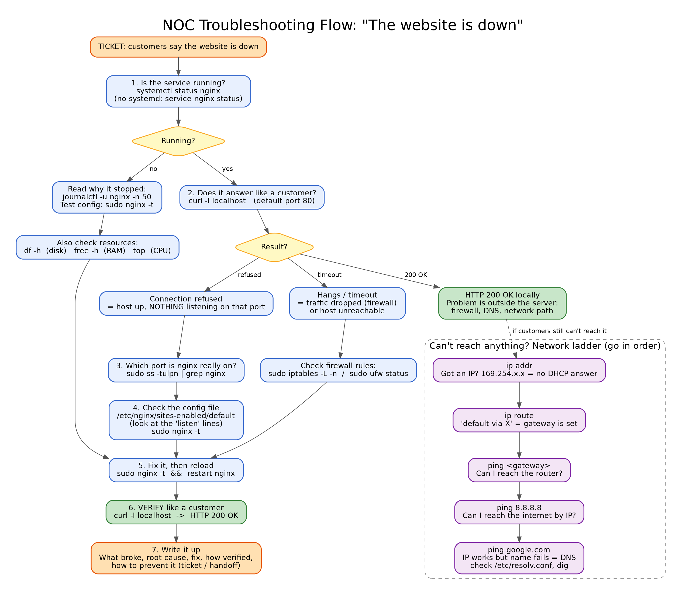
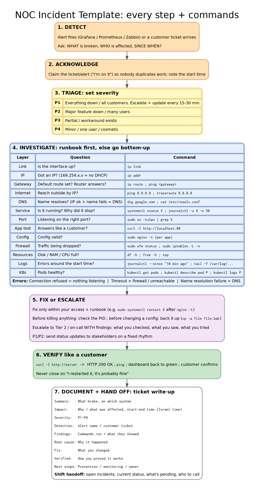

# Lab 04 (NOC): "The website is down", nginx listening on the wrong port

A NOC Tier 1 troubleshooting lab. A web server looks healthy (the service is running), but customers can't reach the site. I worked the ticket end to end: triage, investigation, root cause, fix, verification and the ticket write-up.

## Scenario

> **Ticket:** "Customers say the website on this server is down. Please investigate and fix ASAP."

## Lab setup (how the fault was injected)

```bash
sudo apt update && sudo apt install -y nginx curl
# Fault: change the listen port from 80 to 8080
sudo sed -i 's/listen 80 default_server;/listen 8080 default_server;/; s/listen \[::\]:80 default_server;/listen [::]:8080 default_server;/' /etc/nginx/sites-enabled/default
sudo systemctl restart nginx    # or: sudo service nginx restart
```

## Investigation

| Step | Command | What I saw | What it means |
|---|---|---|---|
| 1. Is the service up? | `sudo systemctl status nginx` (or `service nginx status`) | `nginx is running` | The process is alive, but that doesn't prove the site works |
| 2. Test like a customer | `curl -I localhost` | `Failed to connect to localhost port 80: Could not connect to server` | Host is up, but **nothing is listening on port 80** (connection refused) |
| 3. Which port is nginx on? | `sudo ss -tulpn \| grep nginx` | `0.0.0.0:8080` and `[::]:8080` owned by `nginx` | nginx is listening on **8080**, not 80 |
| 4. Find it in the config | `grep -n listen /etc/nginx/sites-enabled/default` | lines 22 and 23: `listen 8080 default_server;` | Root cause found |

## Fix

```bash
sudo cp -a /etc/nginx/sites-enabled/default /root/default.bak   # back up before editing
sudo nano +22 /etc/nginx/sites-enabled/default                  # 8080 -> 80 on lines 22 and 23
sudo nginx -t                                                   # test the config BEFORE restarting
sudo systemctl restart nginx                                    # or: sudo service nginx restart
```

## Verification

```bash
curl -I localhost                  # HTTP/1.1 200 OK
sudo ss -tulpn | grep nginx        # 0.0.0.0:80 and [::]:80
```

## Incident report

See [incident-report.md](incident-report.md).

## Key lessons

- **"Running" is not "working".** Always test the way a customer would (`curl`).
- **Connection refused** means the host is up but nothing is listening on that port. A **timeout** usually means a firewall is dropping traffic or the host is unreachable. **Name resolution failure** means DNS.
- `ss -tulpn` shows which program is listening on which port: `0.0.0.0` means all interfaces, `127.0.0.1` means local only.
- Back up a config before editing (`cp -a`), and run `nginx -t` before every restart.

## Diagrams

Troubleshooting flow for "the website is down", plus the network ladder (IP, gateway, internet, DNS):



The NOC incident cycle I follow (detect, acknowledge, triage, investigate, fix or escalate, verify, document):


