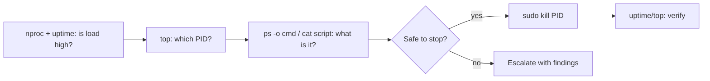

# Lab 06 – NOC: High CPU, server slow (runaway script)

**Role:** NOC / Support Tier 1 · **Platform:** Linux · **Skills:** `nproc`, `uptime` (load average), `top`, `ps`, reading a script, `kill` (SIGTERM vs SIGKILL), ticket write-up

## Scenario
> 🚨 Ticket: "The server is extremely slow, our dashboards keep timing out."

A "log compressor" maintenance script got stuck in an endless busy loop. Two copies ran as root, each using 100% of a CPU core.

## Lab setup (for reproducing)
```bash
sudo tee /usr/local/bin/logcompress >/dev/null <<'EOS'
#!/bin/bash
while :; do :; done      # bug: endless loop, no sleep, no exit
EOS
sudo chmod +x /usr/local/bin/logcompress
for i in 1 2; do sudo setsid nohup /usr/local/bin/logcompress >/dev/null 2>&1 & done
```

## Investigation
| # | Command | What it showed | Why it matters |
|---|---|---|---|
| 1 | `nproc` | 8 cores | Baseline for reading the load |
| 2 | `uptime` | load average `2.35, 2.09, 1.36` | Load rising, about 2 processes running non-stop |
| 3 | `top` | PIDs 98676 + 98678, user root, **100% CPU each** | Finds the culprits (100% = one full core) |
| 4 | `ps -p 98676,98678 -o pid,user,%cpu,etime,cmd` | `/bin/bash /usr/local/bin/logcompress`, running ~22 min | Identifies the process and when it started (matches the ticket) |
| 5 | `cat /usr/local/bin/logcompress` | `while :; do :; done` | Root cause: busy loop with no `sleep` and no exit |

## Fix
```bash
sudo kill 98676 98678        # SIGTERM (15) = polite stop; root-owned, so sudo is needed
ps -p 98676,98678            # only the header line = both gone
# if still running: sudo kill -9 <PID>   (SIGKILL, last resort)
```

## Verification
```bash
uptime                       # 1-minute load drops first; 15-minute follows slowly
top                          # no process stuck at 100%
```

## Key lessons
- **Load average** = processes running or waiting for CPU, over 1/5/15 min. Compare it with `nproc`. Not minutes!
- In `top`, **100% = one full core**. Two processes at 100% each give a load of about 2.
- **Know before you kill:** check what the process is, its owner and its command. Killing a database to "fix CPU" is a new outage.
- `kill` (SIGTERM) first, `kill -9` (SIGKILL) only if it won't stop.
- Double-check PIDs: one wrong digit kills the wrong process.
- Ask "who started it?" (cron?) so it doesn't come back.

## Flow


See [incident-report.md](incident-report.md) for the ticket.
