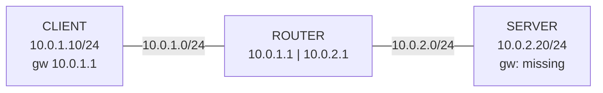

# Lab 08 – NOC: Server can't reach another network (missing default gateway)

**Layer:** OSI Layer 3 (routing) · **Tools:** `ip`, `ping`, `ip route get`

## Scenario
Monitoring reports that server `10.0.2.20` can't reach the client network `10.0.1.0/24`.

## Lab topology (Linux network namespaces)


## Investigation
| Step | Command | Result | Meaning |
|---|---|---|---|
| 1 | `ip -br addr` | eth0 UP, 10.0.2.20/24 | Link and IP OK (L1/L2) |
| 2 | `ping -c 3 10.0.2.1` | 0% loss | Same-subnet traffic OK |
| 3 | `ping -c 3 10.0.1.10` | `Network is unreachable` (instant, local) | No route to other networks |
| 4 | `ip route` | only `10.0.2.0/24 dev eth0 ...` | **No default route** |
| 5 | `ip route get 10.0.1.10` | `RTNETLINK answers: Network is unreachable` | Route lookup fails |

## Fix
```bash
ip route add default via 10.0.2.1
```

## Verification
- `ip route` → `default via 10.0.2.1 dev eth0`
- `ping -c 3 10.0.1.10` → 0% loss, `ttl=126` (one lower than the gateway's 127 = one router hop)

## Lessons
- Same subnet = direct delivery via ARP; other subnets need a **default gateway** on your own subnet.
- "Network is unreachable" is a **local** error (no route), unlike a timeout/100% loss (packets left, nothing returned).
- `ip route add` is **temporary** – persist it in netplan / `/etc/network/interfaces` / NetworkManager, or fix DHCP.
- Escalation style: *what I saw, what I tried, what I suspect.*
