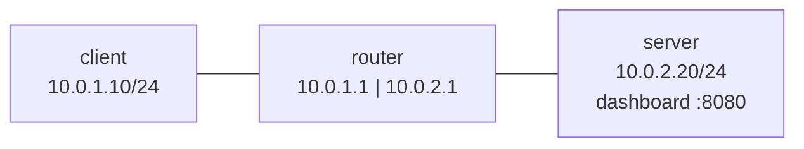

# Lab 09: NOC, "It works on the server, but not from outside" (service bound to localhost)

## Scenario
Users on the client network (10.0.1.0/24) report that the camera dashboard at `http://10.0.2.20:8080` doesn't load.
The developer says: *"It works fine, I tested it on the server."*

## Topology (Linux network namespaces)


## Investigation
| Step | Where | Command | Result | Meaning |
|---|---|---|---|---|
| 1 | client | `curl -v http://10.0.2.20:8080` | `Connection refused` (instant) | The server answered with RST, so the network path works; nothing is listening on that address |
| 2 | server | `ss -tlnp` | `LISTEN 127.0.0.1:8080` (python) | The app listens on loopback only |
| 3 | server | `curl http://127.0.0.1:8080` | page loads | Explains "it works for me" |
| 4 | server | `curl http://10.0.2.20:8080` | refused | Confirms the bind address is the cause |

## Key concept: the Local Address in `ss -tlnp`
| Local Address | Who can connect |
|---|---|
| `127.0.0.1:8080` | Only processes on the server itself (loopback) |
| `0.0.0.0:8080` | Anyone who can reach any of the server's IPs |
| `10.0.2.20:8080` | Only connections arriving on that specific IP |

LISTEN rows show where the app is **listening**, not who is connected.

## Refused vs timeout
- **Refused:** the host answered "nobody's on this port" (RST). The network is fine; look at the service and its bind address.
- **Timeout:** no answer at all. Suspect a firewall drop or routing (see Lab 08).

## Fix
```bash
python3 -m http.server 8080 --bind 0.0.0.0 --directory /srv/labweb
```

## Verification
- `ss -tlnp` shows `0.0.0.0:8080`
- The client's `curl http://10.0.2.20:8080` returns "Camera dashboard"

## Lessons learned
- "Works on the server" plus "refused from outside" usually means a localhost bind (or a host firewall REJECT).
- The bind address is app config, so escalate to the app owner, not the network team.
- Monitor from where the users are, not only from the server.

Full ticket: [incident-report.md](incident-report.md)
