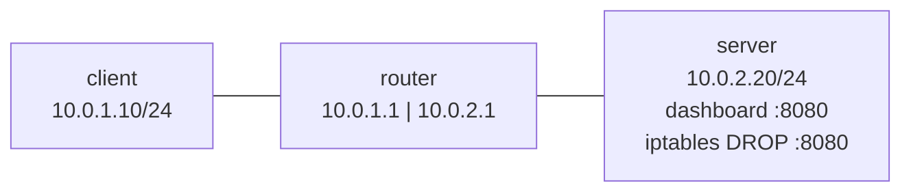

# Lab 10: NOC, "The site just hangs" (firewall DROP, timeout vs refused, tcpdump)

## Scenario
Users on 10.0.1.0/24 say the camera dashboard at `http://10.0.2.20:8080` keeps loading forever. It worked an hour ago.

## Topology (Linux network namespaces)


## Key concept: what the client sees
| Firewall action | Client sees |
|---|---|
| ACCEPT | works |
| REJECT | `Connection refused`, instantly |
| DROP | hangs, then a **timeout** |

Refused means someone answered "no". A timeout means nobody answered (a firewall DROP, routing, or the host is down).

## Investigation
| Step | Where | Command | Result | Meaning |
|---|---|---|---|---|
| 1 | client | `curl -v --max-time 5 http://10.0.2.20:8080` | timed out after 5002 ms | No answer: routing, host down, or DROP |
| 2 | client | `ping -c 3 10.0.2.20` | 3/3 replies | Routing and host OK; only TCP/8080 is affected |
| 3 | server | `tcpdump -n -i eth0 port 8080` | `[S]` x4, same seq, no reply | SYNs reach the server and are eaten locally |
| 4 | server | `iptables -L INPUT -n --line-numbers` | `1 DROP tcp ... dpt:8080` | Found the culprit |

## Reading a tcpdump line
`IP 10.0.1.10.51158 > 10.0.2.20.8080: Flags [S]` means client (ephemeral port 51158) to server port 8080, SYN.

| Flag | Meaning |
|---|---|
| `[S]` | SYN (hello) |
| `[S.]` | SYN-ACK (hello back) |
| `[.]` | ACK |
| `[P.]` | data (push) |
| `[F.]` | FIN (close) |
| `[R]` | RST (go away / refused) |

Tip: `tcpdump -c 5` stops after 5 packets, with no Ctrl+C needed.

## Fix
```bash
iptables -D INPUT 1
```

## Verification
The client's curl returns the dashboard, and tcpdump shows the full handshake, HTTP 200 OK and the FIN close in both directions.

## Lessons learned
- Ping working doesn't mean the service works: ICMP and TCP/8080 are filtered separately.
- tcpdump on the destination tells you whether packets **arrive** and whether anything **leaves**.
- `iptables -D` is not persistent, so check the saved firewall config and find who added the rule.

Full ticket: [incident-report.md](incident-report.md)
