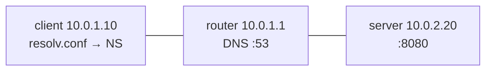

# Lab 11: NOC, works by IP / broken by name (wrong nameserver)

## Scenario
Users can't open `http://camera.lab.local:8080`. `http://10.0.2.20:8080` works.

## Topology

## Key idea
- **Nameserver** = who you ask (`10.0.1.1`)
- **A record** = the answer (`camera.lab.local` → `10.0.2.20`)
- Fault: resolv.conf pointed at dead `10.0.1.99`

Full ticket: [incident-report.md](incident-report.md)
